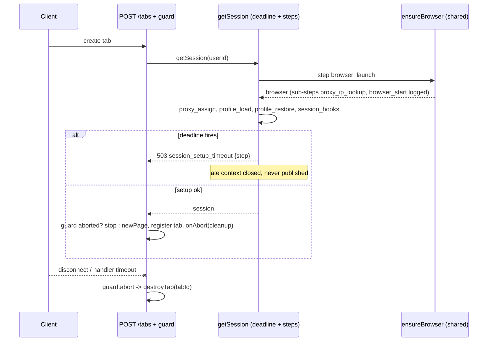

# Session Setup Timeout and Orphan Tab Cleanup - Plan

## Goal Capsule

- **Objective:** An agent that asks Camofox for a tab after a cold start gets a working tab or a fast, retryable error that says which setup step stalled, and no tab is left open for a request that already gave up.
- **Means:** One bounded session-setup deadline with step-level timing logs (KTD1, KTD2), plus a per-request abandonment guard on the tab-creating routes (KTD5).
- **Authority:** Brain ticket `2026-10-18-camofox-time-out-and-log-stalled-session-setup-close-abandon` and its brief are the product source. This plan owns the how. Repo `AGENTS.md` conventions (env reads in `lib/config.js`, OpenAPI JSDoc on route changes) are binding.
- **Execution profile:** Standard. Server-side Node change in `server.js` plus two small `lib/` modules, with unit tests and a live check on a non-production port.
- **Stop conditions:** Stop and report if the live cold start on the test port fails for a reason this change introduced, or if any step would touch the live server on port 9377, its checkout, or its LaunchAgent.
- **Finishes and ships:** Claude Code builds, verifies, and opens a PR on `robertbentleyhq/camofox-browser` against `harden/access-key-and-loopback-bind`. Robert merges and deploys.

---

## Product Contract

### Summary

Wrap browser launch plus browser-context creation in one deadline that logs how long each step took and, on timeout, fails with a 503 that names the stalled step. Track each tab-create request so that, once the client disconnects or the server-side handler times out, any tab that request created is closed at once. Keep the 5-minute browser idle shutdown.

### Problem Frame

The live server closes Camoufox after 5 idle minutes. The next tab pays for a cold start: a Thordata public-IP lookup, a Firefox launch, a per-context proxy session, and a profile restore. Live logs (`/tmp/camofox-launchd.log`, 21 launches and 41 context setups since 2026-10-05) show launch usually takes 5 to 26 s and context setup usually takes under 15 s. Outliers hit 52 s and 215 s for launch (2026-10-15) and 45 s, 58 s, and 232 s for context setup (2026-10-18). The 232 s case sat between `restoring persisted storage state` and `session created`, so the stall was inside the profile restore.

Callers such as Scout give up at 30 s. The server keeps working for up to 180 s (the Thordata tab-create budget), and the work it finishes after that point still creates tabs. On 2026-10-18 two Scout requests returned 500 after 180 s, and their two Reddit tabs appeared 4 minutes later with no owner. They stayed open until the 5-minute tab reaper closed them. Today's logs cannot say which step stalled, because only the step start is logged.

### Requirements

**Bounded, observable session setup**

- R1. Session setup (browser launch when needed, proxy assignment, profile load, context creation with profile restore, session-created hooks) completes or fails within a configurable bound, default 60 s.
- R2. Every setup step logs its name and elapsed milliseconds when it finishes, and the stalled step's name appears in the log line and in the error when the bound is hit.
- R3. A setup timeout returns HTTP 503 with `code: session_setup_timeout`, the stalled `step`, and `retryable: true`, and does not destroy unrelated session state.
- R4. Setup work that finishes after its deadline does not publish a session. A late browser context is closed.

**No orphan tabs**

- R5. When the client of a tab-creating request disconnects, or the server-side handler times out, every tab that request registered is closed, and no further tab is created for it.
- R6. A client disconnect does not cancel shared session setup, so a retry can reuse the setup already in progress.

**Unchanged behavior**

- R7. `BROWSER_IDLE_TIMEOUT_MS` stays at 300000 (5 min).
- R8. A normal cold start, including through Thordata, still returns a working tab.

### Acceptance Examples

- AE1. **Covers R1, R2, R3.** **Given** the profile restore hangs, **when** a client calls `POST /tabs`, **then** within about 60 s the server logs `session setup timed out` with `step: profile_restore` and returns 503 `session_setup_timeout`.
- AE2. **Covers R4.** **Given** AE1 happened, **when** the hung context creation later resolves, **then** the context is closed and `GET /sessions` does not list it.
- AE3. **Covers R5, R6.** **Given** session setup takes 10 s, **when** the client disconnects at 3 s, **then** setup still finishes, no tab is created for that request, and the user's tab count stays 0.
- AE4. **Covers R5.** **Given** a tab was created and its initial navigation is in flight, **when** the client disconnects, **then** the tab's page is closed and removed from its group.
- AE5. **Covers R2, R8.** **Given** a cold server with Thordata configured, **when** one `POST /tabs` arrives, **then** it returns 200 and the log shows timings for `proxy_ip_lookup`, `browser_start`, `proxy_assign`, `profile_load`, `profile_restore` or `context_create`, and `session_hooks`.

### Scope Boundaries

- Raising or removing the 5-minute idle shutdown is out of scope (R7). Keeping the browser warm would hide the stall rather than bound it.
- Cancelling an in-flight Firefox launch or a hung `newContext` call inside Playwright is not attempted. The deadline stops waiting and cleans up what resolves late.
- Per-step budgets were considered and not built. One overall bound covers every step, and the logs already name the slow one. Revisit if logs show one step needs its own limit.
- Automatically retrying a stalled profile restore without the saved profile was considered and not built. It would silently drop Reddit cookies. Revisit if `profile_restore` stalls recur.

### Deferred to Follow-Up Work

- Find the root cause of the 232 s Firefox profile restore (Playwright storage-state restore through Juggler). The new step logs give the evidence.
- Tell Scout's research-sources skill to treat 503 `session_setup_timeout` as retryable instead of waiting out the cold start.

---

## Planning Contract

### Key Technical Decisions

- KTD1. **One overall setup deadline, `SESSION_SETUP_TIMEOUT_MS`, default 60000.** It wraps everything inside the `getSession` creation factory, inside `coalesceInflight`, so the inflight entry clears when the deadline fires and the next request starts a fresh attempt. 60 s sits above every normal launch-plus-setup in the logs and far below the 215 s and 232 s stalls. `0` is not a supported "disable" value. Any non-positive or invalid value falls back to the default.
- KTD2. **A step tracker names the active step.** Steps: `browser_launch` (the shared `ensureBrowser` wait), `proxy_assign`, `profile_load` (the `session:creating` plugin hooks, where persistence reads the profile file), `profile_restore` (`newContext` when `storageState` is set) or `context_create` (when not), and `session_hooks` (the `session:created` plugin hooks). Inside `launchBrowserInstance`, the launch logs its own sub-steps, `proxy_ip_lookup` (camoufox-js `launchOptions`, which runs the geoip public-IP lookup through the proxy) and `browser_start` (`firefox.launch`). It records the current sub-step so a timeout during `browser_launch` reports `proxy_ip_lookup` or `browser_start`.
- KTD3. **An abandoned attempt never publishes.** After the deadline fires, each step boundary checks an abandoned flag. A late context is closed, and `sessions.set` is skipped. The shared browser launch is not cancelled, because a retry may use it.
- KTD4. **Setup timeouts get their own response path.** `classifyError` returns `session_setup_timeout` for the error code. `handleRouteError` answers 503 with `step` and `retryable: true` before its navigation-timeout branch, which would otherwise call `destroySession`.
- KTD5. **A request guard tracks abandonment for tab-creating routes.** It aborts on `res` `close` before the response finished (client disconnect) and on the handler's own timeout. A tab registers a cleanup with the guard right after it joins its group. The cleanup finds the tab by `tabId` in the user's current session, so the proxy-retry path, which re-registers the same `tabId` on a new context, is covered. Cleanup runs at once if the guard is already aborted. Each await boundary that would create more work checks the guard first. Applies to `POST /tabs` and the OpenClaw `POST /tabs/open`.
- KTD6. **New logic lives in `lib/` modules that tests import directly.** `lib/session-setup.js` holds the tracker and deadline. `lib/request-guard.js` holds the abandonment guard. This keeps the code testable without the "mirror the logic" style some existing unit tests use, and it follows `AGENTS.md` separation.

### High-Level Technical Design

### Assumptions

- The brief pre-authorizes the full pipeline (plan, work, review, PR), so scoping confirmation was skipped.
- 60 s is acceptable as the default bound even though some callers stop waiting at 30 s. Those callers can retry, and the retry joins the setup already in progress (R6).
- Node's `ServerResponse` `close` event with `writableFinished === false` is a reliable client-disconnect signal under Express 4 on Node 24.

---

## Implementation Units

### U1. Session setup tracker and deadline

- **Goal:** A reusable tracker that times named steps, enforces one deadline, and reports the active step on timeout (KTD1, KTD2, KTD3).
- **Requirements:** R1, R2, R4
- **Dependencies:** none
- **Files:** `lib/session-setup.js` (new), `tests/unit/sessionSetup.test.js` (new)
- **Approach:**
  1. The tracker is created per setup attempt with a logger, a deadline, and log context (`userId`).
  2. A step helper logs completion with `step` and `ms`, records the active step, and throws if the attempt is already abandoned. It takes an optional `onLate(result)` cleanup that runs when the step's work resolves after the attempt was abandoned, so a late browser context is closed (AE2).
  3. A run helper races the attempt against the deadline. On expiry it marks the attempt abandoned, logs `session setup timed out` with `step`, `elapsedMs`, and per-step timings so far, and rejects with an error carrying `code: session_setup_timeout`, `statusCode: 503`, and `step`.
  4. An optional active-step override lets the launch report its sub-step (KTD2).
- **Patterns to follow:** `withTimeout` and `coalesceInflight` in `server.js` and `lib/inflight.js`.
- **Test scenarios:**
  - Steps that finish in time resolve with the result, and the logger gets one completion line per step with a numeric `ms`.
  - A step that never resolves rejects at the deadline with `code: session_setup_timeout` and `step` equal to that step's name.
  - The timeout log line names the stalled step and lists timings of steps that finished.
  - After the deadline fires, a later step call throws instead of running, and the abandoned flag is true.
  - Covers AE2. A step whose work resolves after the deadline runs its `onLate` cleanup once with the late result, and the attempt does not continue to the next step.
  - A sub-step override reported during a step appears as `step` in the timeout error.
  - A non-timeout error inside a step propagates unchanged and is not reported as a setup timeout.
- **Verification:** The unit tests pass using fake timers or short real deadlines.

### U2. Wire the deadline into getSession and browser launch

- **Goal:** Real session setup uses the tracker, and setup timeouts reach clients as retryable 503s (KTD1 to KTD4).
- **Requirements:** R1, R2, R3, R4, R7, R8
- **Dependencies:** U1
- **Files:** `server.js`, `lib/config.js`, `lib/request-utils.js`, `tests/unit/config.test.js`, `tests/unit/operationalFailures.test.js` or a new `tests/unit/sessionSetupWiring.test.js`, `README.md`
- **Approach:**
  1. Add `sessionSetupTimeoutMs` to `lib/config.js` from `SESSION_SETUP_TIMEOUT_MS`, default 60000.
  2. In `getSession`, run the creation factory through the tracker. Wrap `ensureBrowser`, proxy assignment, `session:creating` hooks, `newContextWithStorageFallback`, and `session:created` hooks as steps.
  3. Pass an `onLate` cleanup that closes the context to the `profile_restore` / `context_create` step, so a late `newContext` is closed and `sessions.set` and the `session:created` hooks are skipped. `sessions.set` runs before the `session:created` hooks (the plugin contract in `lib/plugins.js` says the hooks fire after the context is stored). So if the deadline fires during `session_hooks`, the attempt closes that session with `closeSession` when `sessions.get(key)` is still the one it stored.
  4. In `launchBrowserInstance`, log `proxy_ip_lookup` and `browser_start` timings and publish the current launch sub-step for the tracker.
  5. Add `session_setup_timeout` to `classifyError`, and add an early 503 branch in `handleRouteError`. In `POST /tabs`, keep `session_setup_timeout` out of the Fly `statusCode === 503` replay branch so the response keeps `step` and `retryable`.
  6. Give `POST /tabs` an outer handler budget of at least `SESSION_SETUP_TIMEOUT_MS + HANDLER_TIMEOUT_MS` (for example `Math.max(requestTimeoutMs(), sessionSetupTimeoutMs + HANDLER_TIMEOUT_MS)`). Without a rotating proxy the current budget is 30 s, which would fire before the 60 s setup bound and return a generic timeout instead of the 503 (R3).
  7. Document `SESSION_SETUP_TIMEOUT_MS` in the README env table next to `BROWSER_IDLE_TIMEOUT_MS`.
- **Patterns to follow:** The existing `session proxy assigned` and `session created` log calls, and the `handleRouteError` early-return branches such as `tab_unresponsive`.
- **Test scenarios:**
  - Config: unset gives 60000, a valid value is used, and invalid or non-positive values fall back to 60000.
  - Config: `browserIdleTimeoutMs` default is still 300000 (R7).
  - `classifyError` maps an error with `code: session_setup_timeout` to `session_setup_timeout`.
  - `handleRouteError` answers 503 with `code`, `step`, and `retryable: true` and does not call `destroySession` for a `create_tab` setup timeout.
  - The `POST /tabs` outer budget is never below `SESSION_SETUP_TIMEOUT_MS + HANDLER_TIMEOUT_MS`, with and without a rotating proxy.
- **Verification:** Unit tests pass, and U5 shows step timings in a real cold start.

### U3. Request guard and orphan tab cleanup

- **Goal:** Tabs created for a request that already gave up are closed at once (KTD5).
- **Requirements:** R5, R6
- **Dependencies:** none (U2 for the full flow)
- **Files:** `lib/request-guard.js` (new), `server.js`, `tests/unit/requestGuard.test.js` (new)
- **Approach:**
  1. The guard exposes `aborted`, `reason`, `abort(reason)`, `onAbort(fn)` that runs `fn` at once when already aborted, and `throwIfAborted()`.
  2. It subscribes to `res` `close` and aborts with `client_disconnected` only when the response did not finish.
  3. In `POST /tabs`, check the guard after `getSession` and after the proxy-retry `getSession`, before any `newPage`. After each `newPage` (initial and proxy-retry), first put the tab in its group and register the cleanup that calls `destroyTab` with reason `request_abandoned`, then check the guard. A page returned after abandonment is thus closed at once and never navigates. Abort with `request_timeout` when the handler's `withTimeout` rejects.
  4. In the route's catch, if the guard is aborted, log and stop without calling `handleRouteError`. Closing the abandoned tab makes its in-flight `page.goto` reject with a closed-target error, and `handleRouteError` treats that as a dead context and destroys the whole session, including other requests' tabs.
  5. Apply the same guard, ordering, and catch rule to `POST /tabs/open`. That route has no handler `withTimeout`, so only client disconnect applies there.
  6. Log `tab closed for abandoned request` with `reqId`, `tabId`, and `reason`.
- **Patterns to follow:** `destroyTab` and the navigate route's `AbortController` handling in `server.js`.
- **Test scenarios:**
  - A `res` `close` before finish aborts the guard with `client_disconnected`.
  - A `res` `close` after a finished response does not abort.
  - `onAbort` registered before abort runs once on abort, and `onAbort` registered after abort runs at once.
  - `throwIfAborted` throws an error naming the reason after abort and does nothing before.
  - Covers AE3. With a fake session whose setup resolves after the guard aborts, the route-level flow creates no page.
  - Covers AE4. With a fake page registered in a group, abort closes the page and removes the tab from the group.
  - A disconnect while `newPage` is pending, with the page resolving afterward, leaves the page closed and no group entry.
  - An abandoned request whose navigation then fails with a closed-target error does not destroy the user's session or its other tabs.
- **Verification:** Unit tests pass, and U5 shows zero tabs after a forced timeout and after a client disconnect.

### U4. API contract and docs

- **Goal:** The OpenAPI spec and docs show the new 503 response and the env var.
- **Requirements:** R3
- **Dependencies:** U2
- **Files:** `server.js` (`@openapi` blocks for `POST /tabs` and `POST /tabs/open`), `openapi.json`, `docs/openapi.json` if the generator writes it
- **Approach:** Add a 503 response with the `Error` schema to both routes and regenerate the spec with the repo script.
- **Test expectation:** `tests/unit/openapi.test.js` passes, which fails on a stale `openapi.json`.
- **Verification:** The OpenAPI test is green.

### U5. Live verification on a test port

- **Goal:** Evidence that a real cold start works and logs timings, and that stalls leave no tab (R8, AE1 to AE5).
- **Requirements:** R1 to R8
- **Dependencies:** U2, U3
- **Files:** none committed. A temporary stall plugin and config live in the scratchpad or are reverted before commit.
- **Approach:**
  1. Start the worktree server on port 9388 with its own profile and cookies dirs. Never use port 9377.
  2. Cold start through Thordata with one `POST /tabs` to a light page. Capture the step timing lines. Close the tab. Keep Thordata use to one or two page loads.
  3. Restart without a proxy and with a temporary stall plugin that delays `session:creating`. Run a forced timeout with a short `SESSION_SETUP_TIMEOUT_MS`, and confirm 503 with `step: profile_load`, then zero tabs.
  4. Run a client-disconnect case with curl `--max-time` shorter than the stall and a long setup bound. Confirm zero tabs after setup finishes.
- **Test expectation:** none -- manual runtime verification. Results go into the PR body.
- **Verification:** The captured log lines and `GET /tabs` counts match AE1, AE3, and AE5.

---

## Verification Contract

| Gate | Command | Proves |
|---|---|---|
| Unit tests | `npx jest tests/unit` | U1 to U4 behavior, config defaults, OpenAPI freshness |
| Plugin tests | `npm run test:plugins` | persistence hooks still work with the wrapped steps |
| OpenAPI | `npm run generate-openapi` then `npx jest tests/unit/openapi.test.js` | spec matches routes |
| Live cold start | worktree server on port 9388 with Thordata | AE5, R8 |
| Live stall cases | port 9388, no proxy, temporary stall plugin | AE1, AE3, no leaked tab |

## Definition of Done

- All Verification Contract gates pass, and the live evidence is pasted into the PR body.
- The PR states that `BROWSER_IDLE_TIMEOUT_MS` stays at 5 minutes, and why.
- No temporary stall plugin, config edit, or debug code remains in the diff.
- Nothing touched the live server on port 9377, `~/camofox-browser`, or the LaunchAgent.
